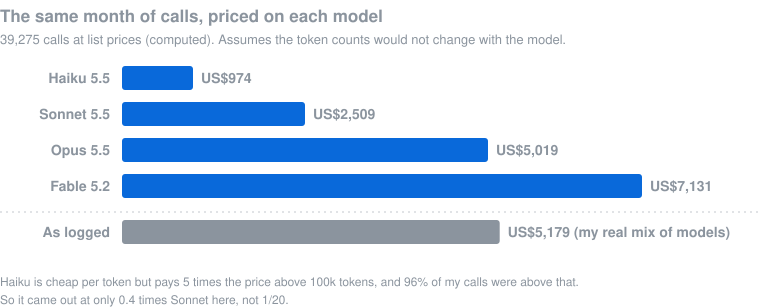

# Picking the model and effort in Claude Code

A one-page guide for choosing a model and an effort level so a task does not cost several times what it needs to.

Numbers marked **measured** are token counts from my own logs (39,275 API calls, 2026-10-19 to 2026-11-19). Numbers marked **computed** are those tokens times API list prices. The table of which model fits which job is my working rule, not a measurement.

## The short version

1. Pick the cheapest model that can do the job. Move up only when it fails.
2. Keep the prompt small. Start a new session for a new task. Prompt size decided more of my cost than the model did.
3. Give subagents their own, cheaper model. By default they run on the model of the chat that starts them.
4. Leave effort at medium. Raise it for one hard problem, then put it back.

## Which model for which job

| Job | Model | Effort |
|---|---|---|
| Find, list, count, look up, summarize a file, run a command and report | Haiku 5.5 | low |
| A clear edit, tests, docs, a refactor with a known target | Sonnet 5.5 | medium |
| Debugging across files, design choices, long multi-step work | Opus 5.5 | medium or high |
| A problem the model above got wrong twice, or work where a wrong answer is costly | Fable 5.2 | high |

If you are unsure, start one row lower than you think you need.

## What the model choice costs

List prices in US$ per million tokens, read on 2026-11-19 (**prices.py**):

| Model | Input | Output | Cache read | Compared with Sonnet 5.5 |
|---|---|---|---|---|
| Haiku 5.5 | 0.10 | 0.50 | 0.01 | 1/20, but see the note below |
| Sonnet 5.5 | 2.00 | 10.00 | 0.10 | 1x |
| Opus 5.5 | 4.00 | 20.00 | 0.20 | 2x |
| Fable 5.2 | 8.00 | 40.00 | 0.20 | 4x on input and output, 2x on cache reads |

Haiku note: a Haiku 5.5 prompt above 100,000 tokens pays 5 times the price on every token of that call. Haiku is the cheap choice for a short, fresh job. It is not a cheap place to continue a long chat.

The same month of my calls, priced on each model (computed; assumes the token counts would not change with the model, which is not true in practice):

| Calls | Haiku 5.5 | Sonnet 5.5 | Opus 5.5 | Fable 5.2 |
|---|---|---|---|---|
| All 39,275 calls | US$974 | US$2,509 | US$5,019 | US$7,131 |
| The 3,713 subagent calls | US$57 | US$176 | US$352 | US$545 |



As logged, on the mix of models I really used, the month was US$5,179 (computed). 96% of my calls had a prompt above 100,000 tokens (measured), which is why Haiku comes out at 0.4x Sonnet here and not 1/20.

Reproduce the two rows on your own logs with the last lines of:

```powershell
python analyze_usage.py
```

## Four ways the bill grows without you noticing

1. **A long chat on an expensive model.** Every call re-reads the whole conversation. 76% of my spend was on main-chat calls with a prompt above 200,000 tokens (computed). Fix: a new session per task, and the `autoCompactWindow` setting (see **STUDY.md**, section 3).
2. **Subagents that copy the main model.** A subagent started from a Fable 5.2 chat runs on Fable 5.2 unless told otherwise. One small job cost US$0.15 on Sonnet 5.5 against US$0.60 on Fable 5.2 (computed from one measured run). Fix: the `/delegate` skill in this repo, or the settings below.
3. **Tiny jobs sent to a subagent.** A subagent's first prompt was about 48,000 tokens before it read anything (measured, two runs). Delegating pays for bulk reading. It does not pay for a one-line lookup.
4. **Fast mode left on.** It doubles every price on the models that have it (list price, not measured here).

## Where to set it

Names checked against the Claude Code docs on 2026-11-19.

| What | How |
|---|---|
| Model for this session | `/model` in the chat, or `claude --model sonnet` at start |
| Effort for this session | `/effort medium` (levels: `low`, `medium`, `high`, `xhigh`, `max`) |
| Model for one subagent | `model: haiku` in the subagent file's frontmatter |
| Default model for all subagents | environment variable `CLAUDE_CODE_SUBAGENT_MODEL=sonnet` |
| One job on a cheaper model, from any chat | `/delegate` (this repo) |

A subagent file with no `model` line runs on the model of the chat that starts it. I have not tested `CLAUDE_CODE_SUBAGENT_MODEL` myself yet.

## Effort

Effort sets how much the model thinks before it answers. Thinking is billed as output tokens, the most expensive kind. My logs do not record the effort level of a call, so I have no measured number for it.

What I can say from the logs: output was 15% of my computed spend, and re-reading and re-writing the prompt was 84%. So for my usage, prompt size and model were the bigger levers, and effort the smaller one (inference).

My working rule: medium by default, low for lookups, high or above for one hard problem (a bug that survived two tries, timing, geometry, architecture), then back to medium.

## Limits

- One person's logs, one month, mostly long coding sessions. Your mix will differ.
- Dollars are API list prices times measured tokens. On a subscription plan this is not your bill.
- The job table is judgment. I have not measured answer quality per model.
- Not measured: what switching the model in the middle of a session does to the prompt cache.
