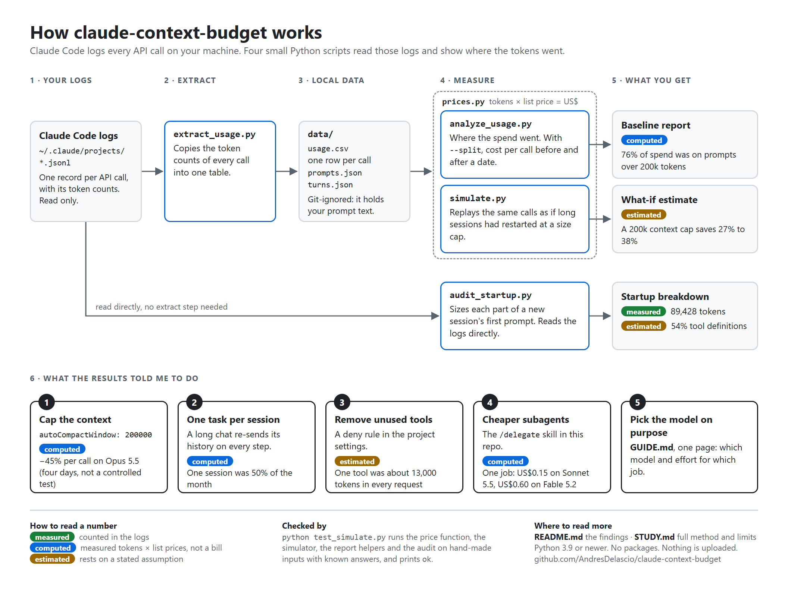

# claude-context-budget

A study of where my Claude Code tokens went over one month, and the small Python tool that measured it, which you can run on your own logs.

## The question

My usage limit kept running out. The usual advice is "pick a cheaper model". I wanted to know if that was really the problem, so I read my own logs: 39,275 API calls in 90 sessions, Oct 19 to Nov 19, 2026.

The answer was no. The model mattered less than **how long each session had grown**. Claude re-sends the whole conversation on every step, so a session at 400k tokens pays for those 400k tokens again on each tool call.


## How to read the numbers

- **Measured:** token, call and character counts read from the logs.
- **Computed:** measured tokens times API list prices. I am on a subscription, so this is not what I paid. It makes sessions and models comparable.
- **Estimated:** simulator results and per-part token counts, which rest on stated assumptions.

## Five findings

| # | Finding | Evidence | Kind |
|---|---|---|---|
| 1 | Long sessions, not the model, drove the cost | 76% of spend was on calls with a prompt over 200k tokens. One session alone was 50% of the month | computed |
| 2 | One built-in setting cut the cost per call almost in half | Opus 5.5 cost per call fell from US$0.137 to US$0.075 (-45%) after I capped the context at 200k | computed from measured tokens, not a controlled test |
| 3 | A new session is already large before you type | First prompt of 89,428 tokens. 54% is tool definitions. My own `CLAUDE.md` is 2% | total measured, shares estimated |
| 4 | Subagents copy the main chat's model | The same small job cost US$0.15 on Sonnet 5.5 and US$0.60 on Fable 5.2 | computed from one measured run |
| 5 | The cheapest model is not always cheap | Haiku 5.5 pays 5 times the price above 100k tokens. 96% of my calls were above that | price published, share measured |

Two results surprised me:

- **A tighter cap is not better.** A 150k cap saves less than a 200k cap (30.6% against 35.2%, estimated), because every fresh session has to write its starting prompt to the cache again.
- **Delegating a tiny job loses money.** A subagent starts at about 48,000 tokens before it reads anything (measured, two runs).

The full method, tables and limits are in **[STUDY.md](STUDY.md)**.

## What to do about it

In order of effect on my usage:

| Step | How | Effect on my usage |
|---|---|---|
| 1. Cap the context | Add `"autoCompactWindow": 200000` to `~/.claude/settings.json` | -45% per call on Opus 5.5. The simulator puts it at 27% to 38% of the whole month (estimated) |
| 2. One task per session | Start a new session when the task changes | Part of the same estimate |
| 3. Remove tools you do not use | A deny rule in the project's `.claude/settings.local.json` | One tool was 37,384 characters (measured), about 13,000 tokens in every request (estimated) |
| 4. Keep one-project skills in that project | Move them from `~/.claude/skills` to the project's `.claude/skills` | About 1,500 tokens (estimated), and 28 skill descriptions that had been cut off came back (measured) |
| 5. Give subagents a cheaper model | The `/delegate` skill in this repo | About 4 times cheaper for one job. Subagents were only 7.2% of my spend, so a small lever for me |
| 6. Pick the model on purpose | **[GUIDE.md](GUIDE.md)**, one page | The same month costs US$2,509 on Sonnet 5.5 and US$7,131 on Fable 5.2 (computed, assumes equal tokens) |

I use steps 1, 3 and 4 every day.

## How it works

[](how_it_works.pdf)

Click the image for the PDF.

## Run it on your own logs

You need Python 3.9 or newer. No packages to install. Everything stays on your machine.

1. Download this folder and open a terminal in it.
2. Extract your usage. This only reads your logs in `~/.claude/projects`:
   ```
   python extract_usage.py
   ```
3. See where your spend went (per day, model, session and prompt size):
   ```
   python analyze_usage.py
   ```
4. Estimate what a context cap would have saved you:
   ```
   python simulate.py
   ```
5. See what fills a new session before you type. This reads the logs directly, so it works without step 2:
   ```
   python audit_startup.py
   ```

Useful options:

```
python simulate.py --cap 250 200            # try other caps, in thousands of tokens
python simulate.py --trim-startup 30        # also try a 30k smaller startup prompt
python simulate.py --since 2026-11-12       # only calls from this date
python simulate.py --sensitivity --cap 200  # how much the two assumed values matter
python analyze_usage.py --split 2026-11-16  # cost per call before and from a date
python audit_startup.py path/to/session.jsonl  # audit one chosen session
```

To install `/delegate` for all your projects, copy one folder (PowerShell):

```powershell
Copy-Item -Recurse .claude\skills\delegate $HOME\.claude\skills\
```

Then type, in any Claude Code chat:

```
/delegate list every assumed constant in simulate.py
```

**Privacy:** the extract step writes three files into **data/**, which is git-ignored because it holds the first 200 to 300 characters of your prompts. Nothing is uploaded.

## Check the code

```
python test_simulate.py
```

It runs the price function, the simulator, the report helpers and the startup audit on hand-made inputs with known answers, and prints `ok`.

## Limits

- One person, one month, mostly long coding sessions in the Claude desktop app. Your mix will differ, which is why the tool runs on your logs.
- Dollars are list prices times measured tokens, not a bill.
- The before and after comparison is not a controlled test: the work differs, and the second period is four days.
- The simulator assumes the same work after a checkpoint. It does not model answer quality. Its result moves from 38% to 27% as the assumed carry-over grows from 5,000 to 50,000 tokens.
- `/delegate` has two measured runs, both small jobs.

## Files

- **STUDY.md** is the full write-up: method, tables and limits for every finding.
- **GUIDE.md** is the one-page guide for picking a model and an effort level.
- **how_it_works.png** and **how_it_works.pdf** are the one-page map of the repo. **how_it_works.html** is their source.
- **extract_usage.py** reads the Claude Code logs and writes one row per API call to **data/usage.csv**.
- **prices.py** holds the price table and the function that turns tokens into dollars.
- **analyze_usage.py** prints the baseline report and, with `--split`, the before and after comparison.
- **simulate.py** runs the what-if comparison and the sensitivity check.
- **audit_startup.py** sizes each part of a session's first prompt.
- **.claude/skills/delegate/SKILL.md** is the `/delegate` skill.
- **test_simulate.py** checks the scripts above.
- **CHANGELOG.md** lists what changed and when.

## Next

- More startup trims (connectors, the skills list budget, other unused tools), each measured like the first two.
- More measured `/delegate` runs, on bulk reading jobs where it should pay.
- A longer before and after comparison. The one here covers four days.

## About

Built by Andres Delascio, mechanical engineering grad. Human-led engineering with AI-assisted implementation (Claude Code) and manual verification. Every number comes from running these scripts on my own logs.

Licence: MIT, see **LICENSE**.
