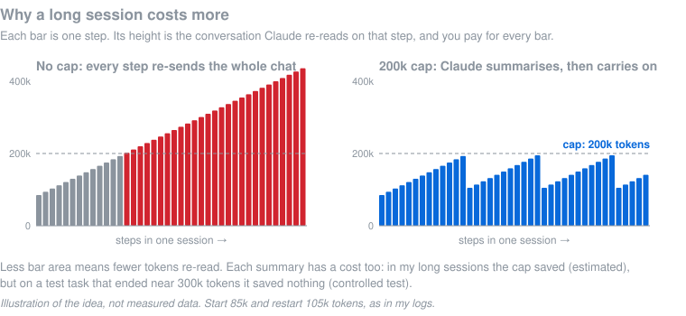
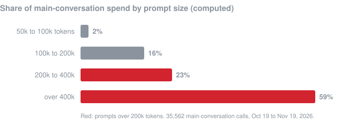
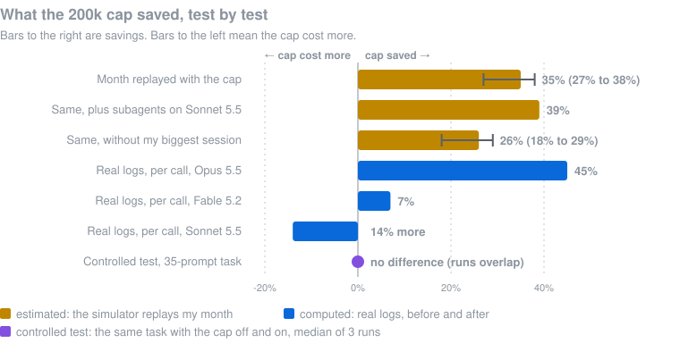
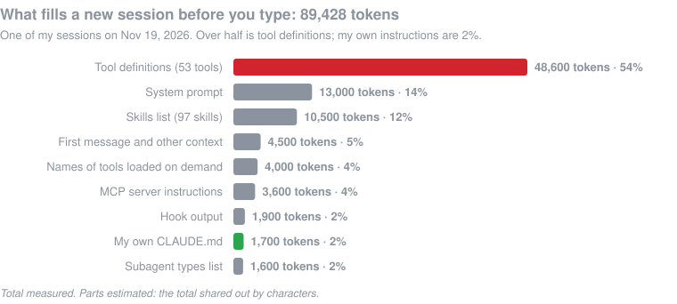
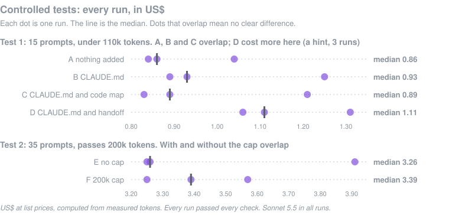
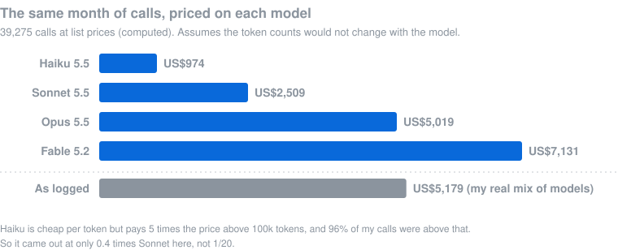
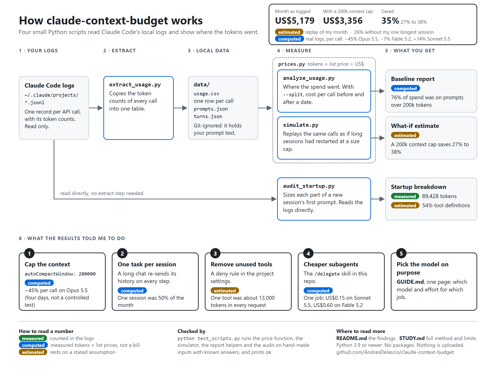

# claude-context-budget

[](https://github.com/AndresDelascio/claude-context-budget/actions/workflows/test.yml)
[](LICENSE)

A study of where my Claude Code tokens went over one month, and the small Python tool that measured it, which you can run on your own logs.

## In short

**Claude Code's usage is counted in tokens, and it re-sends the whole conversation on every step.** So the longer a session grows, the more each step costs.

I read one month of my own logs (39,275 API calls) to see where my usage went. Long sessions, not the choice of model, drove most of it. One built-in setting caps a session at 200,000 tokens: past that, Claude summarises the chat so far and carries on from the summary. Replaying my month with that cap cuts its cost at list prices by an estimated 35%.



Numbers are marked measured (read from the logs), computed (tokens times list prices, not a bill) or estimated (rests on a stated assumption). The scripts run on your own logs with Python 3.9 or newer, no installs, and nothing is uploaded ([Run it on your own logs](#run-it-on-your-own-logs)).

## The question

My usage limit kept running out. The usual advice is "pick a cheaper model". I wanted to know if that was really the problem, so I read my own logs: 39,275 API calls in 90 sessions, Oct 19 to Nov 19, 2026.

The answer was no. The model mattered less than **how long each session had grown**. Claude re-sends the whole conversation on every step, so a session at 400k tokens pays for those 400k tokens again on each tool call.



## The result

One month of my real usage, with and without the one setting this study points to (a 200k cap on the context):



| | Without | With | Saved |
|---|---|---|---|
| The month, replayed by the simulator (estimated) | US$5,179 | US$3,356 | **US$1,823, or 35%** (27% to 38%) |
| Same, plus subagents on Sonnet 5.5 (estimated) | US$5,179 | US$3,154 | **US$2,025, or 39%** |
| Same replay, leaving out the one session that was half the month (estimated) | US$2,567 | US$1,908 | **US$660, or 26%** (18% to 29%) |
| Real logs, cost per call on Opus 5.5, before and after (computed) | US$0.137 | US$0.075 | **45%** |
| Real logs, cost per call on Fable 5.2 (computed) | US$0.167 | US$0.155 | **7%** |
| Real logs, cost per call on Sonnet 5.5 (computed) | US$0.036 | US$0.041 | **none: 14% more** |
| Controlled test, one 35-prompt task on Sonnet 5.5 that ends near 300k tokens (median of 3 runs) | US$3.26 | US$3.39 | **none** (runs overlap) |

- "Without" is the month as logged: 39,275 API calls, measured tokens at API list prices. An open-source tool, ccusage, counts the same tokens to within 0.01% ([STUDY.md](STUDY.md), section 1).
- The first three rows replay those same calls with the cap, so they rest on the simulator's stated assumptions. One session was 50% of the month, so the third row shows the result without it.
- The last three rows are what really happened after I turned the setting on: four days of data, not a controlled test. The cap helps where prompts were long. My Opus 5.5 prompts had a median of 370k tokens before, Fable 5.2 199k, and Sonnet 5.5 111k, which was already under the cap (measured).
- Cost per typed prompt fell too (Opus 5.5 median US$1.24 to US$0.46, computed), but my requests in those four days were also smaller: 12 calls per prompt against 39 (measured). So the real logs cannot separate the cap from the change in work.
- The last row is a controlled test: the same scripted task with the cap off and on. The cap cut the tokens re-read by 22%, but on a task that only just passes 200k the two compactions cost as much as they saved. So the 35% is an estimate for long sessions like mine, not a promise for every task.
- Dollars are list prices, not a bill. I am on a subscription, so for me the saving is usage, not money. I assume the usage limit counts tokens roughly the way the prices do, so read the same percentages as usage.

## How to read the numbers

- **Measured:** token, call and character counts read from the logs.
- **Computed:** measured tokens times API list prices. I am on a subscription, so this is not what I paid. It makes sessions and models comparable.
- **Estimated:** simulator results and per-part token counts, which rest on stated assumptions.

## Seven findings

| # | Finding | Evidence | Kind |
|---|---|---|---|
| 1 | Long sessions, not the model, drove the cost | 76% of spend was on calls with a prompt over 200k tokens. One session alone was 50% of the month | computed |
| 2 | One built-in setting cut the cost per call where sessions were long | After I capped the context at 200k, cost per call fell 45% on Opus 5.5 (US$0.137 to US$0.075) and 7% on Fable 5.2. Sonnet 5.5, already under the cap, rose 14% | computed from measured tokens, not a controlled test |
| 3 | A new session is already large before you type | First prompt of 89,428 tokens. 54% is tool definitions. My own `CLAUDE.md` is 2% | total measured, shares estimated |
| 4 | Subagents copy the main chat's model | The same small job cost US$0.15 on Sonnet 5.5 and US$0.60 on Fable 5.2 | computed from one measured run |
| 5 | The cheapest model is not always cheap | Haiku 5.5 pays 5 times the price above 100k tokens. 96% of my calls were above that | price published, share measured |
| 6 | On a small task, a project file or a code map saved nothing | Same 15-prompt task, 3 runs each: US$0.86 with nothing, US$0.93 with a `CLAUDE.md`, US$0.89 with a code map too. All passed the same 18 checks | controlled test, tokens measured, medians |
| 7 | On a task that only just passes 200k, the cap saved tokens but not money | Same 35-prompt task, 3 runs each: US$3.26 without the cap, US$3.39 with it. 22% fewer prompt tokens, two compactions per run, all 32 checks passed both ways | controlled test, tokens measured, medians |





Three results surprised me:

- **A tighter cap is not better.** A 150k cap saves less than a 200k cap (30.6% against 35.2%, estimated), because every fresh session has to write its starting prompt to the cache again.
- **Delegating a tiny job loses money.** A subagent starts at about 48,000 tokens before it reads anything (measured, two runs).
- **The model ignored the code map.** In the controlled test it never opened the map, though the project file told it to. A handoff to a fresh session halfway cost more, not less (US$1.11), because the context was still small.

The full method, tables and limits are in **[STUDY.md](STUDY.md)**.

## What to do about it

In order of effect on my usage:

| Step | How | Effect on my usage |
|---|---|---|
| 1. Cap the context | Add `"autoCompactWindow": 200000` to `~/.claude/settings.json` | -45% per call on Opus 5.5. The simulator puts it at 27% to 38% of the whole month (estimated) |
| 2. One task per session | Start a new session when the task changes | Part of the same estimate |
| 3. Remove tools you do not use | A deny rule in the project's `.claude/settings.local.json` | One tool was 37,384 characters (measured), about 13,000 tokens in every request (estimated) |
| 4. Keep one-project skills in that project | Move them from `~/.claude/skills` to the project's `.claude/skills` | About 1,500 tokens (estimated), and 28 skill descriptions that had been cut off came back (measured) |
| 5. Give subagents a cheaper model | The `/delegate` skill in this repo | About 4 times cheaper for one job. Subagents were only 7.2% of my spend, so a small lever for me |
| 6. Pick the model on purpose | **[GUIDE.md](GUIDE.md)**, one page | The same month costs US$2,509 on Sonnet 5.5 and US$7,131 on Fable 5.2 (computed, assumes equal tokens) |



I use steps 1, 3 and 4 every day.

Not on this list: writing a project file or building a code map to save tokens. On a small task neither changed the cost (finding 6). A short `CLAUDE.md` is still useful for telling Claude things it cannot see in the code.

## How it works

[](figures/how_it_works.pdf)

Click the image for the PDF.

## Run it on your own logs

You need Python 3.9 or newer. No packages to install. Everything stays on your machine.

1. Download this folder and open a terminal in it.
2. Extract your usage. This only reads your logs in `~/.claude/projects`:
   ```
   python extract_usage.py
   ```
3. See where your spend went (per day, model, session and prompt size):
   ```
   python analyze_usage.py
   ```
4. Estimate what a context cap would have saved you:
   ```
   python simulate.py
   ```
5. See what fills a new session before you type. This reads the logs directly, so it works without step 2:
   ```
   python audit_startup.py
   ```

Useful options:

```
python simulate.py --cap 250 200            # try other caps, in thousands of tokens
python simulate.py --trim-startup 30        # also try a 30k smaller startup prompt
python simulate.py --since 2026-11-12       # only calls from this date
python simulate.py --sensitivity --cap 200  # how much the two assumed values matter
python simulate.py --without-top 1          # leave out your costliest session
python analyze_usage.py --split 2026-11-16  # cost per call and per typed prompt, before and from a date
python audit_startup.py path/to/session.jsonl  # audit one chosen session
```

No logs yet? Try the reports on the made-up data in **sample/**:

```
python analyze_usage.py --data sample
python simulate.py --data sample
```

To install `/delegate` for all your projects, copy one folder (PowerShell):

```powershell
Copy-Item -Recurse .claude\skills\delegate $HOME\.claude\skills\
```

Then type, in any Claude Code chat:

```
/delegate list every assumed constant in simulate.py
```

**Privacy:** the extract step writes three files into **data/**, which is git-ignored because it holds the first 200 to 300 characters of your prompts. Nothing is uploaded.

## Check the code

```
python test_scripts.py
```

It runs the extractor, the price function, the simulator, the report helpers, the startup audit and the experiment's cost summary on hand-made inputs with known answers, runs both reports on **sample/**, and prints `ok`.

GitHub runs the same check on Ubuntu 24.04 and Windows with Python 3.9 on every pull request (**.github/workflows/test.yml**). The badge at the top shows the last result on `main`.

## Limits

- One person, one month, mostly long coding sessions in the Claude desktop app. Your mix will differ, which is why the tool runs on your logs.
- Dollars are list prices times measured tokens, not a bill.
- The before and after comparison is not a controlled test: the work differs (a third as many calls per prompt), and the second period is four days.
- One session was 50% of the month. Without it the simulated saving is 26%, not 35%.
- The simulator assumes the same work after a checkpoint. It does not model answer quality. Its result moves from 38% to 27% as the assumed carry-over grows from 5,000 to 50,000 tokens.
- The simulator only models the cap. `/clear` between tasks and Claude Code's clearing of old tool results also shrink a session, and their savings are not counted.
- `/delegate` has two measured runs, both small jobs.
- The controlled tests are one small repo, one model and three runs per set-up. The cap test ends near 300,000 tokens, so it does not show what the cap does in the much longer sessions where most of my spend was.

## Files

- **STUDY.md** is the full write-up: method, tables and limits for every finding.
- **GUIDE.md** is the one-page guide for picking a model and an effort level.
- **figures/** holds the charts and the one-page map of the repo (**how_it_works.png** and **.pdf**, made from **how_it_works.html**). Each chart is a small SVG file whose numbers come from STUDY.md, noted in a comment at its top.
- **extract_usage.py** reads the Claude Code logs and writes one row per API call to **data/usage.csv**.
- **prices.py** holds the price table and the function that turns tokens into dollars. It lists six models. Calls on any other model are left out, and the scripts say how many.
- **analyze_usage.py** prints the baseline report and, with `--split`, the before and after comparison.
- **simulate.py** runs the what-if comparison and the sensitivity check.
- **audit_startup.py** sizes each part of a session's first prompt.
- **.claude/skills/delegate/SKILL.md** is the `/delegate` skill.
- **experiment.py** runs the controlled test (it calls the model). **experiment_task.py** holds its prompts and checks.
- **test_scripts.py** checks the scripts above.
- **sample/** holds made-up usage data in the same format as **data/**: 16 invented sessions, not from anyone's logs. Its numbers mean nothing; it only lets you try the reports.
- **CHANGELOG.md** lists what changed and when.
- **CITATION.cff** says how to cite this study. GitHub shows it as **Cite this repository**.

## Next

- More startup trims (connectors, the skills list budget, other unused tools), each measured like the first two.
- More measured `/delegate` runs, on bulk reading jobs where it should pay.
- The cap test on a task that runs to 500k tokens or more, and on Opus 5.5, to find where the cap starts to pay.
- The code map on a larger repo, where grep is not enough.
- A longer before and after comparison. The one here covers four days.

## About

Built by Andres Delascio, mechanical engineering grad. Human-led engineering with AI-assisted implementation (Claude Code) and manual verification. Every number comes from running these scripts on my own logs.

Licence: MIT, see **LICENSE**.
