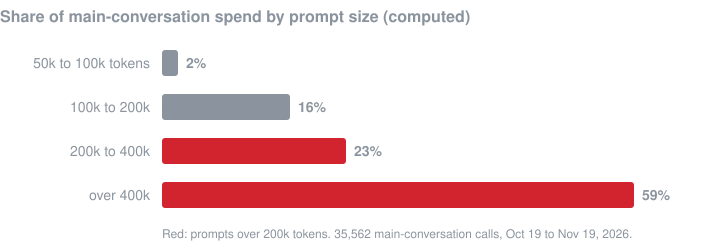
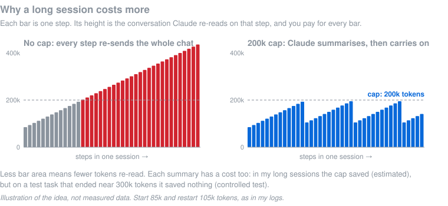
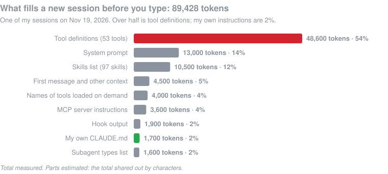
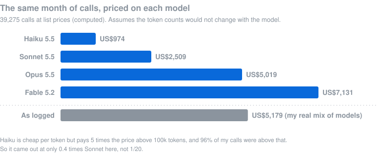
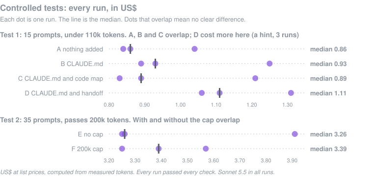

# The study: method and evidence

This is the full write-up behind the [README](README.md). Each section gives the numbers, how they were produced, and their limits.

Data: one month of my own Claude Code logs, Oct 19 to Nov 19, 2026, 39,275 API calls, 90 sessions. Sections 8 and 9 are separate: controlled tests of 18 scripted runs.

Three kinds of number appear, and each one is labelled:

- **Measured:** token counts, call counts and character counts read from the logs.
- **Computed:** measured tokens times API list prices (**prices.py**). I am on a subscription, so this is not what I paid. It makes sessions and models comparable.
- **Estimated:** simulator results, which also depend on assumed values, and tokens per part of a prompt, shared out by characters.

Contents:

1. [Baseline](#1-baseline)
2. [What-if simulator](#2-what-if-simulator)
3. [Measured before and after](#3-measured-before-and-after)
4. [How the simulator works](#4-how-the-simulator-works)
5. [What fills a new session](#5-what-fills-a-new-session)
6. [Delegate a job to a cheaper model](#6-delegate-a-job-to-a-cheaper-model)
7. [The same calls on each model](#7-the-same-calls-on-each-model)
8. [Controlled test: project file, code map, handoff](#8-controlled-test-project-file-code-map-handoff)
9. [Controlled test: the 200k cap](#9-controlled-test-the-200k-cap)

## 1. Baseline

| Result | Value | Kind |
|---|---|---|
| Cost at API list prices | US$5,179 | computed from measured tokens |
| Spend on calls with a prompt over 200k tokens | 76% | computed |
| Sessions that ever passed 200k tokens | 24 of 90 (measured), holding 95% of spend | computed |
| Largest single session | 50% of spend; median prompt 463k tokens (measured) | computed |
| Spend by token type | cache reads 56%, cache writes 28%, output 15%, fresh input under 1% | computed |
| Subagents | 7.2% of spend | computed |
| Prompt size of a brand-new session | 85k tokens (median) | measured |



I am on a subscription, so US$5,179 is not what I paid. It is what the same tokens cost at list prices, which makes sessions and models comparable.

### Checked against ccusage

[ccusage](https://github.com/ccusage/ccusage) is an open-source tool that reads the same logs. On 2026-11-20 I ran its Claude report (version 20.0.51, `--offline`, so it uses its built-in price list) and compared it day by day with **data/usage.csv**.

| Oct 19 to Nov 18, 39,053 calls | This repo | ccusage | Difference |
|---|---|---|---|
| Input tokens | 654,273 | 654,277 | +4 |
| Output tokens | 36,468,658 | 36,469,301 | +643 |
| Cache write tokens | 179,087,185 | 179,094,824 | +7,639 |
| Cache read tokens | 14,505,982,313 | 14,505,986,296 | +3,983 |
| US$ at list prices (computed) | 5,150.83 | 5,150.83 | 0.00 |

- The two agree to within 0.01% on every token type and to the cent on dollars. Each Claude model matched on its own as well.
- Days are local dates (US Eastern), as ccusage groups them. Nov 19 is left out: my extract stopped at 18:42 UTC that day, and ccusage also counted the calls logged after.
- Its default report also includes other coding tools' logs (GPT models, here). Its `claude` report, used above, does not.

## 2. What-if simulator

`simulate.py` replays the same calls under different habits. The idea, drawn as a picture (an illustration, not data):



| Habit | Cost | Saved |
|---|---|---|
| As logged | $5,179 | |
| Start a new session past 300k tokens | $3,543 | 31.6% |
| Start a new session past 200k tokens | $3,356 | 35.2% |
| Start a new session past 150k tokens | $3,595 | 30.6% |
| Run subagents on Sonnet 5.5 | $4,976 | 3.9% |
| 200k cap + Sonnet subagents | $3,154 | 39.1% |
| 200k cap + Sonnet subagents + 30k less startup overhead | $2,921 | 43.6% |

These are estimates, not measurements. They depend on the assumptions listed under [How the simulator works](#4-how-the-simulator-works). The 30k startup saving in the last row is assumed, not yet shown to be achievable.

One session was 50% of the month, so I ran the same replay without it (`python simulate.py --cap 200 --without-top 1`):

| Habit | Cost | Saved |
|---|---|---|
| As logged, without the costliest session | $2,567 | |
| Start a new session past 200k tokens | $1,908 | 25.7% |
| 200k cap + Sonnet subagents | $1,785 | 30.5% |

Without that session the saving moves from 29% to 18% as the assumed carry-over grows from 5,000 to 50,000 tokens (estimated). So about a quarter, not a third, for a month without one very long session.

Three results worth noting:

1. **A checkpoint is not free.** A new session has to write its starting prompt to the cache again. That is why a 150k cap saves less than a 200k cap: it forces 1,211 restarts instead of 504.
2. **Cheap tokens still add up.** A cache read costs 5% of a normal input token on Opus 5.5, yet cache reads are 56% of the total, because every call re-reads the whole history. Both are published rules: Claude Code [sends the full conversation with every request](https://code.claude.com/docs/en/costs.md#why-usage-climbs-in-a-long-session), and a [cache read on Opus 5.5 is 0.05 times the input price](https://platform.claude.com/docs/en/build-with-claude/prompt-caching#pricing).
3. **Subagent model choice was a small lever for me.** Subagents were 7.2% of my spend. Someone who delegates more will see a bigger number.

## 3. Measured before and after

Claude Code already has the cap built in, as one setting. This line in `~/.claude/settings.json` makes it summarize the conversation before the prompt reaches 200k tokens:

```json
"autoCompactWindow": 200000
```

The same thing can be set inside a session with `/autocompact 200k`. Both are described in the [Claude Code docs](https://code.claude.com/docs/en/model-config.md#set-the-auto-compact-window).

My settings file has this line. From Nov 17 on, no prompt in my logs is above 170k tokens. On Nov 16, 19 of 1,396 calls still were, the largest at 251k. Before that, the median Opus 5.5 prompt was 370k. The table compares the main-conversation calls before Nov 16 with the calls from Nov 16 to Nov 19:

| Model | Period | Calls | US$ per call | of which cache reads | Median prompt |
|---|---|---|---|---|---|
| Opus 5.5 | before | 31,018 | 0.137 | 0.084 | 370k |
| Opus 5.5 | from Nov 16 | 1,891 | 0.075 | 0.026 | 136k |
| Fable 5.2 | before | 1,260 | 0.167 | 0.051 | 199k |
| Fable 5.2 | from Nov 16 | 874 | 0.155 | 0.026 | 135k |
| Sonnet 5.5 | before | 163 | 0.036 | 0.011 | 111k |
| Sonnet 5.5 | from Nov 16 | 156 | 0.041 | 0.012 | 126k |

Token counts and call counts are measured. Dollars are computed at list prices.

- **Opus 5.5: 45% cheaper per call.** This is where my long sessions were. Almost all of the drop is cache reads.
- **Fable 5.2: 7% cheaper per call.** Cache reads halved, but cache writes went up, so the net gain is small.
- **Sonnet 5.5: 14% more per call.** These sessions were never near the cap, so the cap had nothing to cut.

The comparison is per call and per model because the two periods hold different amounts of work and a different mix of models. Reproduce it with:

```
python analyze_usage.py --split 2026-11-16
```

### Per typed prompt

A cheaper call is no saving if the same request now takes more calls. So the same command also groups the calls by the prompt I typed: every call, main conversation or subagent, belongs to the last prompt typed before it in its session.

| Model | Period | Typed prompts | Median US$ per prompt | Mean US$ per prompt | Calls per prompt |
|---|---|---|---|---|---|
| Opus 5.5 | before | 823 | 1.24 | 5.25 | 38.6 |
| Opus 5.5 | from Nov 16 | 182 | 0.46 | 0.88 | 12.4 |
| Fable 5.2 | before | 51 | 2.09 | 5.22 | 31.8 |
| Fable 5.2 | from Nov 16 | 66 | 1.78 | 1.88 | 12.5 |

Prompt and call counts are measured. Dollars are computed. Sonnet 5.5 had fewer than 20 typed prompts in a period and is left out.

Cost per prompt fell more than cost per call. Most of that is not the cap: a prompt in the second period set off about a third as many calls, so the requests themselves were smaller. This table does not show the cap adding calls, and it does not show the cap saving money per task either. Only a controlled test, the same task with the cap on and off, can separate the two.

Limits of this comparison:

- It is not a controlled test. The work before and after is not the same work, and the second period is only four days.
- I did not record the day I changed the setting. Nov 16 is the first day in the logs where almost no spend sits above 200k. That the setting caused the drop is my inference from the prompt sizes.

### Checking the simulator against real compactions

The same command lists the real compactions in the second period, which lets me check the simulator's assumptions:

| | Simulator | Logs from Nov 16 (67 compactions) |
|---|---|---|
| Prompt after a checkpoint | 104,801 tokens (85k measured start + 20k assumed) | 106,375 tokens, median, measured |
| Cache re-written after a checkpoint | 56,051 tokens (36k measured + 20k assumed) | 49,009 tokens, median, measured |

The assumed values are close to what happened, and the cache re-write is slightly on the costly side. Compaction started at a median prompt of 165,921 tokens. The first call after each compaction adds up to 13% of main-conversation spend in that period (computed), so a checkpoint is a real cost, not a rounding error.

After the cap, a typical prompt is about 136k tokens, and about 85k of that is there before I type anything. That startup prompt is now the largest part left to cut.

## 4. How the simulator works

For each main conversation it tracks a simulated prompt size. The simulated prompt grows by the same amount as the real one. When it passes the cap, the simulator charges a checkpoint and continues from a fresh session. Each call is then re-priced with the smaller prompt: new content costs the same, only the re-read history shrinks.

| Input | Kind | Value |
|---|---|---|
| Token counts per call | measured | from the `usage` field in the logs |
| Prices | published | **prices.py**, read from [Anthropic's pricing page](https://platform.claude.com/docs/en/about-claude/pricing#model-pricing) on 2026-11-19 |
| Size of a fresh session | measured | median first prompt of your sessions (85k for me) |
| Cache re-write of a fresh session | measured | median non-cached part of a first prompt (36k for me) |
| Summary written at a checkpoint | assumed | 4,000 output tokens |
| Context carried into the fresh session | assumed | 20,000 tokens (summary plus files read again) |
| Subagents on a cheaper model | assumed | same token counts as on the original model |

Limits:

- It assumes the work after a checkpoint takes the same calls and the same output as before. It does not model quality.
- Dollar figures use list prices. They are not a subscription bill.
- The assumed values sit at the top of **simulate.py**.
- It only models the cap. Other ways to shrink a session, such as `/clear` between tasks or Claude Code clearing old tool results ([costs docs](https://code.claude.com/docs/en/costs.md)), are not simulated, so their savings are neither counted nor separated from the cap's in the real logs.

### How much the two assumed values matter

```
python simulate.py --sensitivity --cap 200
```

Estimated saving of the 200k cap on my logs, for each pair of assumed values (the number of checkpoints is in brackets):

| Summary written | 5,000 carried over | 20,000 | 50,000 | 100,000 |
|---|---|---|---|---|
| 1,000 tokens | 38.6% (443) | 35.8% (504) | 28.2% (712) | -24.3% (2,612) |
| 4,000 tokens | 38.0% (443) | **35.2% (504)** | 27.4% (712) | -27.4% (2,612) |
| 16,000 tokens | 35.9% (443) | 32.7% (504) | 23.9% (712) | -40.0% (2,612) |

The bold cell is the one used everywhere else in this study.

1. **The summary size hardly matters.** A summary 16 times longer moves the result by about 3 points.
2. **What a fresh session carries over matters a lot.** From 5,000 to 50,000 tokens the saving falls from 38% to 27%.
3. **Carry over too much and the cap costs money.** With 100,000 tokens carried over, a fresh session starts at 185k, hits the 200k cap again almost at once, and the month costs 27% more than as logged.

The 20,000 value is supported by the real compactions in section 3: the median prompt after one was 106k tokens, against 105k in the simulator. So I quote the 200k cap as **about 27% to 38%, 35% at the value my logs support**, not as one number.

## 5. What fills a new session

`audit_startup.py` reads the first request of a session from the logs and sizes each part of it. This is one of my sessions in the Claude desktop app on Nov 19, before I typed a word of real work:

| Part | Characters | Share | Tokens (estimated) |
|---|---|---|---|
| Tool definitions (53 tools) | 137,130 | 54% | 48,600 |
| System prompt | 36,544 | 14% | 13,000 |
| Skills list (97 skills) | 29,705 | 12% | 10,500 |
| First message and other context | 12,655 | 5% | 4,500 |
| Names of tools loaded on demand (268) | 11,309 | 4% | 4,000 |
| MCP server instructions | 10,198 | 4% | 3,600 |
| Hook output | 5,228 | 2% | 1,900 |
| Instruction files (`CLAUDE.md`) | 4,915 | 2% | 1,700 |
| Subagent types list | 4,502 | 2% | 1,600 |
| **Total** | 252,186 | 100% | **89,428 (measured)** |



Characters are measured. The total of 89,428 tokens is measured. Tokens per part are estimated: the measured total is shared out by characters.

What stands out:

- **Tool definitions are over half.** One built-in tool for publishing pages is 37,384 characters, about 13,000 tokens. The 19 tools of the built-in browser are another 22,433 characters.
- **My own instructions are small.** `CLAUDE.md` is 2% of the startup prompt. Trimming it would save almost nothing.
- **40 skills I installed for one project load in every project.** They sit in my personal skills folder and take 14,023 characters, about 5,000 tokens, in every session.
- **Connectors cost tokens even when unused.** One data connector I rarely use adds 67 tool names and its instructions: 6,712 characters, about 2,400 tokens.

Run it on your own most recent session:

```
python audit_startup.py
```

### First trim, measured

Skills in `~/.claude/skills/` load in all projects. Skills in `.claude/skills/` inside a project load only there ([skills docs](https://code.claude.com/docs/en/skills.md)). I moved the 40 one-project skills into that project and audited a new session in this folder:

| | Before | After |
|---|---|---|
| Skills in the list | 97 | 57 |
| Skills listed by name only, no description | 28 | 0 |
| Skills list, characters | 29,705 | 25,520 |

All three rows are measured.

- **The saving is smaller than I expected.** The 40 skills took 14,023 characters, but the list shrank by only 4,185, about 1,500 tokens (estimated).
- **The reason is a size budget.** Claude Code caps the skills list. With 97 skills mine was at the cap, so 28 skills were cut down to a bare name. With 40 gone, the freed room went back to those 28 descriptions.
- **The real gain is quality, not size.** Claude can now read what every installed skill is for. Before, it could not for 28 of them.

The first prompt of the test session was 85,156 tokens against 89,428 (both measured). Most of that drop is my shorter first message, not the trim, so I do not count it as a saving.

### Second trim, measured: a deny rule removes a tool, after a restart

A deny rule with a bare tool name removes that tool from the prompt ([permissions docs](https://code.claude.com/docs/en/permissions.md)). I put this in `.claude/settings.local.json` inside one project, so it applies only there:

```json
{
  "permissions": {
    "deny": ["Artifact"]
  }
}
```

`Artifact` is the 37,384-character publishing tool from the table above. For the test I also denied a second, smaller tool as a control.

| Request | Tools sent | Tool definitions, characters |
|---|---|---|
| New session, app not restarted | both tools still there | unchanged |
| Same project, after restarting the app | both tools gone, nothing else changed | 145,037 → 102,875 |

Both rows are measured from the logged requests.

- **A brand-new settings file needed an app restart.** A new session alone did not pick it up in the desktop app. Once the file was loaded, a later edit to it took effect in the running session: when I removed the control rule, that tool came back without a restart.
- **Denying the one tool removes 37,384 characters**, about 13,000 tokens (estimated) from every request in that project.
- **The cost:** Claude cannot publish pages from that project while the rule is on. Only deny tools you do not use there.

The second row comes from a session I resumed after the restart, not a brand-new one. The tool list is what was sent, so the character numbers hold, but I have not yet measured the token total of a new session with the rule on.

### Not tried yet

- An MCP server added at local scope loads only in that project ([MCP docs](https://code.claude.com/docs/en/mcp.md)).
- The skills docs describe a setting for the size budget of the skills list.

Limits of the audit:

- It is one session. My first prompts range from 73k to 95k tokens (measured, 83 sessions in November).
- Sharing tokens out by characters assumes every part has the same characters per token. Tool definitions are JSON and prose is not, so the per-part numbers can be off.
- All my sessions run in the desktop app. A terminal session loads fewer tools and will look different.
- It needs a recent Claude Code version. Older logs do not record the request.

## 6. Delegate a job to a cheaper model

A subagent started from a chat on the top model runs on the top model too, unless told otherwise ([sub-agents docs](https://code.claude.com/docs/en/sub-agents.md#choose-a-model)). `/delegate` is a small skill that hands one job to one subagent on the cheapest model that fits, so the main chat never has to switch models.

```
/delegate list every assumed constant in simulate.py
/delegate sonnet add a test for the --since option
```

What the skill tells Claude to do:

1. Pick the model. A word in front (`haiku`, `sonnet`, `opus`) forces it. Otherwise:

   | Job | Model |
   |---|---|
   | Find, list, count, look up, read and summarize, run a command and report | Haiku |
   | A well-specified edit, writing tests or docs | Sonnet |
   | Hard debugging, design, costly if wrong | Opus |

2. Write a brief of under 200 words: goal, files, what is already known, what done looks like, and a reply of at most 15 lines.
3. Start one subagent on that model and tell it not to start agents of its own.
4. Check the reply against the files before reporting, and say which model ran.

Install it for all your projects by copying one folder (PowerShell):

```powershell
Copy-Item -Recurse .claude\skills\delegate $HOME\.claude\skills\
```

### One measured run

I ran the steps of the skill once on the first example above, from a chat on Fable 5.2:

| | Value | Kind |
|---|---|---|
| Model the subagent ran on | Haiku 5.5 | measured |
| API calls | 4 | measured |
| Tokens | 56,695 cache write, 156,079 cache read, 2,168 output | measured |
| Agents started by the subagent | 0 | measured |
| Cost on Haiku 5.5 | US$0.01 | computed |
| Same tokens on Sonnet 5.5 | US$0.18 | computed, assumes the same token counts |
| Same tokens on Fable 5.2 | US$0.68 | computed, assumes the same token counts |

All four constants it reported were at the lines it gave. I checked them against the file.

Two things this run shows:

- **A subagent has its own startup cost.** Its first prompt was 47,954 tokens (measured) before it read anything. Delegating a tiny job does not pay. Delegating bulk reading does.
- **The model choice matters most per job, not per month.** This job was about 70 times cheaper on Haiku than on Fable. Subagents were still only 7.2% of my spend.

### The typed command, in a new session

I then typed `/delegate` in a new session on Fable 5.2 and asked it to run the tests. From that session's log, all measured:

- The subagent ran on Sonnet 5.5, in 3 API calls, and started no agents of its own.
- The brief was 191 words.
- The main chat re-ran the test command itself before reporting, and ended with `Ran on: sonnet.`

The subagent cost US$0.15 (computed), against US$0.60 for the same tokens on Fable 5.2. Its first prompt was 48,643 tokens.

That run also showed a flaw. "Run the tests" should have gone to Haiku, but the table said "tests" under Sonnet. I changed the rows to "run a command and report" (Haiku) and "writing tests" (Sonnet). The changed table is not re-tested.

Limits: two runs, both small jobs. For a job this small, delegating costs more than doing it in the main chat, because of the subagent's startup. I did not compare answer quality between models.

## 7. The same calls on each model

The same month of my calls at each model's list price (computed; assumes the token counts would not change with the model):

| Calls | Haiku 5.5 | Sonnet 5.5 | Opus 5.5 | Fable 5.2 |
|---|---|---|---|---|
| All 39,275 calls | US$974 | US$2,509 | US$5,019 | US$7,131 |
| The 3,713 subagent calls | US$57 | US$176 | US$352 | US$545 |



Haiku 5.5 is 1/20 the price of Sonnet 5.5 per token, but only 0.4x here. A Haiku prompt above 100,000 tokens pays 5 times the price ([long context pricing](https://platform.claude.com/docs/en/about-claude/pricing#long-context-pricing)), and 96% of my calls were above that (measured). `python analyze_usage.py` prints both rows at the end of its report.

**GUIDE.md** turns this into a one-page guide: which model fits which job, and where to set it.

## 8. Controlled test: project file, code map, handoff

Sections 1 to 7 read my own logs, where the work changes from day to day. This section is a controlled test: the same scripted task, run by Claude Code in four set-ups, with everything else held equal.

| Arm | Set-up |
|---|---|
| A | Nothing added |
| B | A `CLAUDE.md` project file (59 lines, written once by the model: test commands, conventions, where to export names) |
| C | The same file, plus a graphify code map and a note telling the model to read the map first |
| D | The same file, plus a handoff: after prompt 7 the model writes **HANDOFF.md**, and the rest runs in a new session that reads it |

The task is 15 prompts sent in order into one conversation, on [click](https://github.com/pallets/click) 8.1.7 (a command-line library, about 10,000 lines of source). Ten prompts ask for a change (two new parameter types, a `deprecated` argument for options, a sort switch for groups, docs, a changelog). Five ask a "where is" or "what calls" question. The prompts are in **experiment_task.py**. The model is Sonnet 5.5 in every arm, with the same tools allowed and my own `CLAUDE.md`, skills and connectors kept out. Each arm ran 3 times.

Quality is checked two ways: click's own test suite, and 18 checks in **experiment_task.py** that run the finished code. The untouched repo passes 1 of the 18.

| Arm | Run 1 | Run 2 | Run 3 | Median US$ | Median API calls | Largest prompt (tokens) | Checks passed | Map uses |
|---|---|---|---|---|---|---|---|---|
| A, nothing | 1.04 | 0.86 | 0.84 | 0.86 | 63 | 91,799 | 18/18, 3 times | 0 |
| B, project file | 0.93 | 1.25 | 0.89 | 0.93 | 57 | 108,570 | 18/18, 3 times | 0 |
| C, file and map | 1.21 | 0.89 | 0.83 | 0.89 | 56 | 106,600 | 18/18, 3 times | 0 |
| D, file and handoff | 1.11 | 1.06 | 1.31 | 1.11 | 71 | 83,394 | 18/18, 3 times | 0 |

Tokens are measured from the session transcripts. Dollars are computed at list prices, and they equal the cost Claude Code itself reported in all 12 runs. Writing the project file took one extra session of US$0.13, not included above. The whole test used US$12.35.

Every run of this test and of section 9, one dot per run:



What the 12 runs show:

- **The project file saved nothing measurable.** The same set-up varied by up to 40% from run to run (B: US$0.89 to US$1.25). A, B and C overlap completely.
- **The model never opened the map.** In all C runs there were zero tool calls that ran `graphify` or read its output, though the project file told it to. On a repo this size it searched with grep. So this test cannot say what a map does when it is used.
- **The handoff cost more.** D's cheapest run (US$1.06) is above A's dearest (US$1.04). With three runs each that is a hint, not a proven difference. It fits section 2: a fresh session only pays off once the context is large, and here no prompt passed 110,000 tokens.
- **Quality was the same.** Every run passed all 18 checks. Click's suite showed one failure in every run, a Windows-only file name test that also fails on the untouched repo.

Limits:

- One small, well-known repo, one model, and a task that stayed under 110,000 tokens of context. My logs put 76% of the spend above 200,000 tokens, and this test does not reach that range. It does not test the 200k cap; section 9 does.
- Three runs per arm. A difference smaller than the run-to-run spread would not show.
- All 18 checks passed everywhere, so the checks could not show a quality difference if there was one.
- The harness sends each prompt as a new `claude -p --resume` process. That re-writes about 9,000 tokens to the cache per prompt (measured once), which a live session would not do. It is the same in every arm.
- The four arms of a round ran at the same time, so they may share cached prompt parts.

Run it yourself (it calls the model, so it uses your subscription or API credit):

```
python experiment.py --pilot      # one run per arm
python experiment.py --runs 3     # three runs per arm
```

It needs the `claude` CLI logged in, git, and `graphify` on your PATH for arm C. Raw records go to **data/experiment/**, which is git-ignored.

## 9. Controlled test: the 200k cap

Section 8 stayed under 110,000 tokens, so it could not test the cap. This section uses a longer task that passes 200,000 tokens, run with the cap off and on.

| Arm | Set-up |
|---|---|
| E | The long task, no cap |
| F | The long task, with `autoCompactWindow` set to 200,000 |

The long task is the 15 prompts of section 8 plus 20 more, 35 in all, in one conversation on the same repo and model (click 8.1.7, Sonnet 5.5). Eight of the new prompts are reviews that read a whole file, which is what fills a real session. The others add features that build on the earlier ones. Quality is checked with 32 checks; the untouched repo passes 1. Each arm ran 3 times.

| Arm | Run 1 | Run 2 | Run 3 | Median US$ | Median API calls | Median prompt tokens | Largest prompt (tokens) | Compactions per run | Checks passed |
|---|---|---|---|---|---|---|---|---|---|
| E, no cap | 3.91 | 3.26 | 3.25 | 3.26 | 122 | 15.5 million | 308,186 | 0 | 32/32, 3 times |
| F, 200k cap | 3.39 | 3.57 | 3.25 | 3.39 | 155 | 12.0 million | 168,886 | 2 | 32/32, 3 times |

Tokens are measured from the session transcripts. Dollars are the cost Claude Code itself reported. For arm E that equals my own sum at list prices. For arm F it is about US$0.22 higher per run, because the calls that write the summary are billed but are not in the transcript. The six runs used US$20.63.

Where the money went, mean of 3 runs (computed from measured tokens at Sonnet 5.5 list prices):

| Part | E, no cap | F, 200k cap |
|---|---|---|
| Reading the cached conversation | US$1.65 | US$1.12 |
| Writing to the cache | US$1.14 | US$1.34 |
| Output | US$0.69 | US$0.72 |
| Writing the summaries (billed, not in the transcript) | US$0.00 | US$0.22 |
| Total | US$3.48 | US$3.40 |

What the 6 runs show:

- **The cap did what it should to the tokens.** The model re-read 22% fewer prompt tokens (median 12.0 against 15.5 million), and no call went over 169,000 tokens. Without the cap, about a third of the calls were over 200,000.
- **It saved no money on this task.** Median US$3.39 with the cap against US$3.26 without. The runs overlap (F: US$3.25 to US$3.57, E: US$3.25 to US$3.91), so the honest reading is "no difference", not "4% more".
- **The saving on reading was spent on compacting.** Reading fell by US$0.53 a run. Writing the summaries, re-writing the cache after each one, and about 30 extra API calls took almost all of it back.
- **Quality was the same.** All 6 runs passed all 32 checks, with two compactions in every capped run. Click's suite showed the same single Windows-only failure as in section 8.

How this fits the rest of the study:

- The simulator in section 2 gives 35% for my month, where sessions ran far past 200,000 tokens for hundreds of calls. This task passed 200,000 only in its last third and stopped near 300,000. A compaction has a fixed price, and here there were too few calls after it to pay it back. The same effect is in **test_scripts.py** (`test_checkpoints_have_a_price`).
- It agrees with section 3: after I turned the cap on, cost per call fell on the models whose prompts were long and rose 14% on Sonnet 5.5, whose prompts were short.
- So the controlled test supports the direction of the simulator (fewer tokens read, a price per compaction), but it does not confirm the 35%. That figure stays an estimate for long sessions.

Limits:

- One repo, one model, three runs per arm, and a task that ends near 300,000 tokens. It does not show what the cap does at 500,000 or more, which is where most of my spend was.
- Three runs per arm can only show a large difference. With the spread measured here (pooled standard deviation US$0.29 a run), a two-sided t-test at 5% significance and 80% power needs a difference of about US$0.88 a run, 25% of arm E's mean, to detect it. Five runs per arm would bring that to US$0.59 (17%), ten runs to US$0.38 (11%) (computed). So "no difference" here means "no difference larger than about 25%".
- All 32 checks passed everywhere, so they could not show a quality loss if there was one. The model can also re-read files after a compaction, which hides what it forgot.
- The harness sends each prompt as a new `claude -p --resume` process, which re-writes about 9,000 tokens to the cache per prompt (measured once, in section 8). That raises the "writing to the cache" row in both arms.
- The two arms of a round ran at the same time, so they may share cached prompt parts.
- One check was corrected after the first round. The prompt asks for a host name type without naming it, both runs named it `HOSTNAME`, and the check only accepted `HOST`. It now accepts either. The prompts did not change.
- The cap setting only accepts 100,000 to 1,000,000 tokens. A lower value is ignored (measured with 40,000: no compaction).

Run it yourself:

```
python experiment.py --runs 3 --arms EF
```

## Sources

Anthropic's published docs, checked on 2026-11-20, and one outside tool. Everything else in this study comes from my own logs and runs.

- [ccusage](https://github.com/ccusage/ccusage) 20.0.51: an independent count of the same logs (section 1).
- [Pricing](https://platform.claude.com/docs/en/about-claude/pricing): list prices, long context pricing for Haiku 5.5, fast mode pricing.
- [Prompt caching](https://platform.claude.com/docs/en/build-with-claude/prompt-caching): cache write and read prices, the 5-minute default lifetime.
- [Manage costs](https://code.claude.com/docs/en/costs.md): why usage climbs in a long session, `/clear`, auto-compaction.
- [Model configuration](https://code.claude.com/docs/en/model-config.md#set-the-auto-compact-window): the `autoCompactWindow` setting and `/autocompact`.
- [Sub-agents](https://code.claude.com/docs/en/sub-agents.md#choose-a-model): a subagent runs on the main conversation's model by default.
